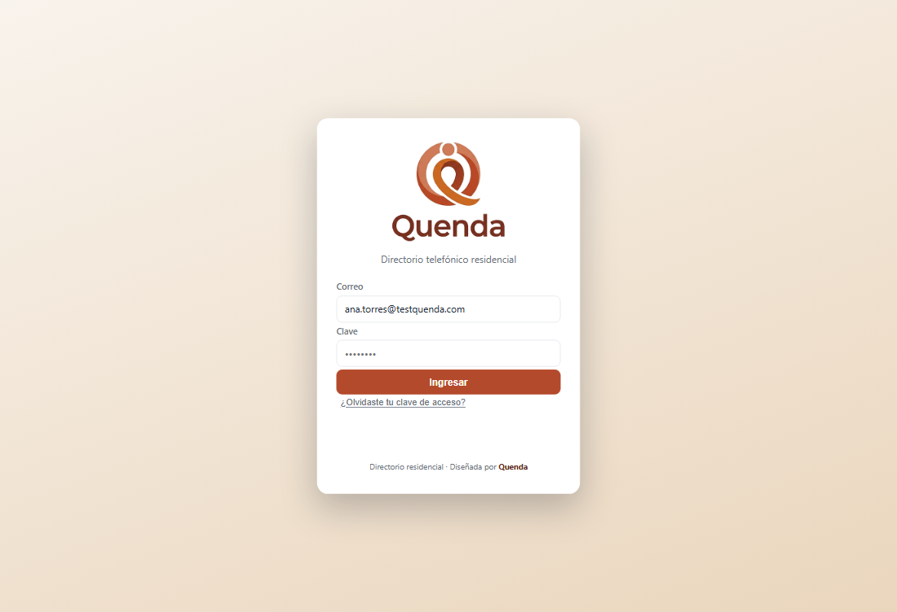
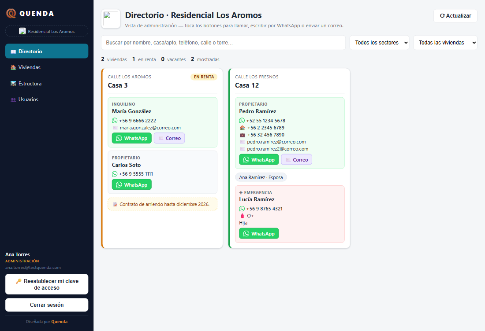
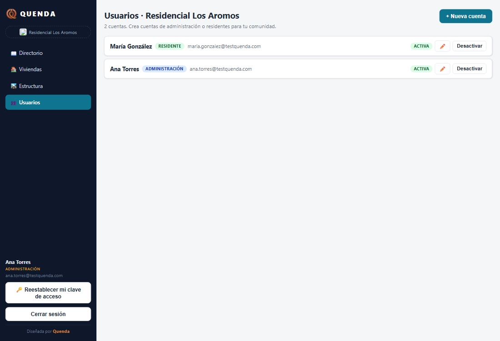
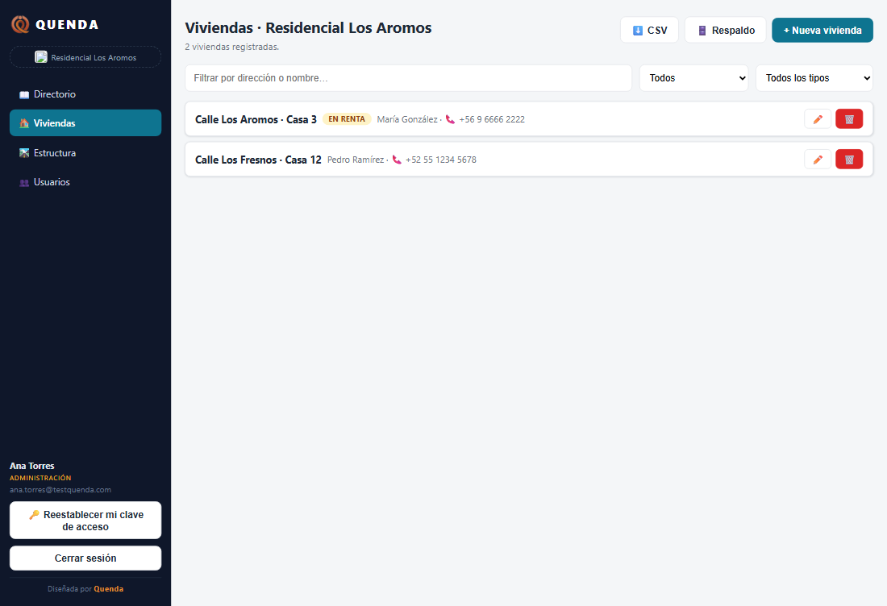
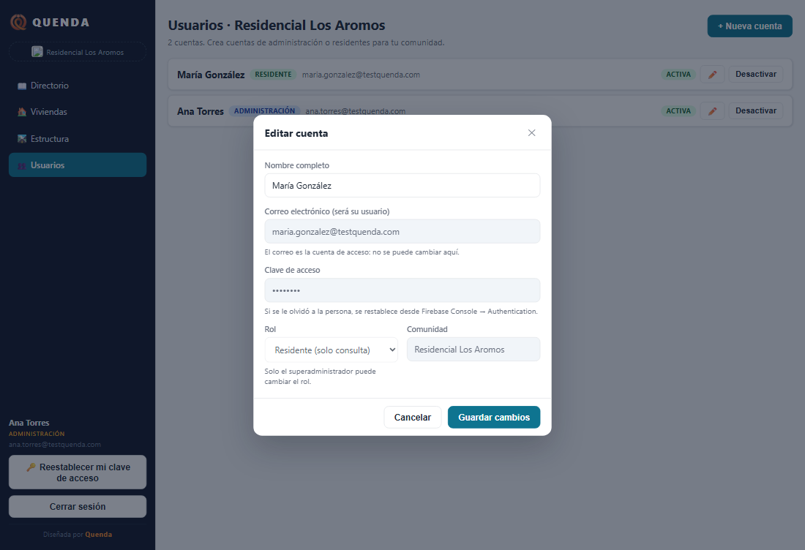
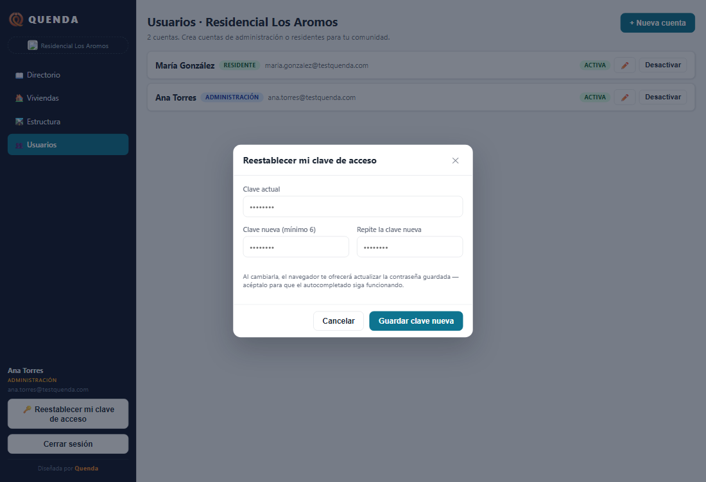

# QUENDA — Directorio telefónico residencial

Aplicación web para que varias comunidades residenciales guarden y consulten en
línea el **directorio de vecinos** de cada casa: titular, inquilino, contacto de
emergencia, teléfonos con código de país, correos, WhatsApp y avisos de renta.

- **Sin frameworks:** JavaScript vainilla + módulos ES.
- **Datos en la nube:** Google Firebase (Authentication + Firestore).
- **Todo en español**, pensada primero para el celular.
- Los residentes solo **consultan**; las cuentas de administración editan.

## Así se ve

| Vista | Captura |
| --- | --- |
| Inicio de sesión |  |
| Directorio (tarjetas por vivienda) |  |
| Usuarios de la comunidad |  |
| Viviendas (con Excel, importar y plantilla) |  |
| Editar cuenta (roles y protecciones) |  |
| Cambiar mi propia clave |  |

*Las capturas corresponden a la comunidad de demostración «Residencial Los
Aromos» (datos ficticios de prueba) — ningún dato real queda expuesto.*

## Características

- 📖 **Directorio** con búsqueda y filtros (sector, vivienda), tarjetas por
  casa con propietario / inquilino, botón directo de **WhatsApp** (solo si hay
  celular) y correo.
- 🏠 **Viviendas y estructura** (calles, sectores), estados «en renta» con
  inquilino y aviso de contrato.
- 👥 **Usuarios** con roles `superadmin`, `admin` y `residente`; la ficha de
  cada persona protege su identidad: el correo y el rol de una cuenta no se
  cambian desde la app (reglas de Firestore), y nadie puede cambiarse el rol
  a sí mismo.
- 🔑 **Claves:** «¿Olvidaste tu clave de acceso?» envía el correo oficial de
  Firebase en español; con la sesión abierta cada quien cambia su clave desde
  el menú.
- 📊 **Exportar a Excel real (.xlsx)** de viviendas: cada dato en su columna y
  fila; e **importar** desde .xlsx o .csv con revisión previa fila por fila
  (incluye segundo correo y plantilla descargable). **Respaldo** por
  comunidad.

## Estructura

```
quenda/
├── index.html            ← app (una sola página)
├── css/ base.css, componentes.css
├── js/  app.js · auth.js · db.js · estado.js · exportar.js ·
│        firebase-config.js · paises.js · ui.js
│   └── paginas/  comunidades · directorio · estructura · usuarios · viviendas
├── img/ logo e isotipo
├── shots/ capturas de pantalla
├── firestore.rules      ← reglas publicadas en Firebase
└── README-QUENDA.md     ← documentación operativa (cuentas de prueba, etc.)
```

## Probarla en local

Sirve la carpeta con cualquier servidor estático (los módulos ES no corren con
`file://`):

```powershell
# Windows
python -m http.server 8322
# ó
npx http-server -p 8322
```

Abre `http://localhost:8322`.

## Seguridad

- `js/firebase-config.js` contiene únicamente la configuración **pública** de
  Firebase (como cualquier app web de Firebase); la protección real vive en
  las **reglas de Firestore** (`firestore.rules`, ya publicadas) que limitan
  lectura/escritura por rol y comunidad.
- Los datos reales de las comunidades se administran con cuentas de
  superadministrador; en este repositorio solo existe la comunidad de
  demostración con datos ficticios.
